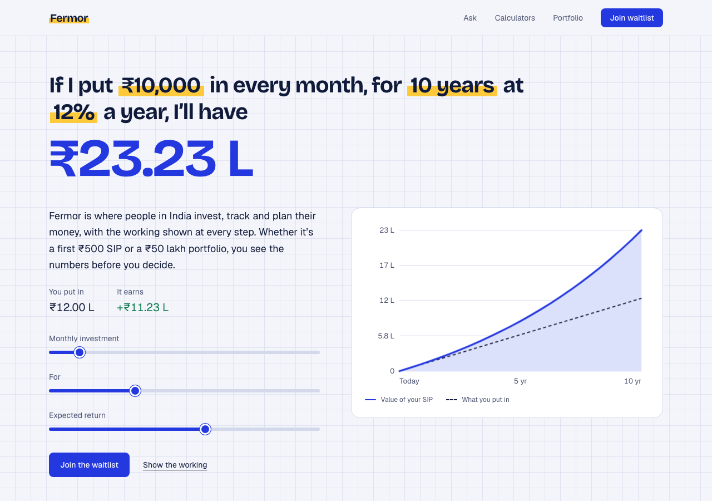

# Fermor homepage

A homepage for [Fermor](https://www.fermor.in), built for the frontend assignment.

**Live:** https://fermor-one.vercel.app  
**Source:** https://github.com/nawazish2/fermor-homepage



The page is built around one idea: Fermor's real strength is that it shows its working, so the homepage should too. The headline is a sentence you can edit ("If I put ₹10,000 in every month, for 10 years at 12% a year, I'll have ₹23.23 L"), and the answer is the biggest thing on the page.

## Run it

```bash
npm install
npm run dev          # http://localhost:3000
npm test             # unit tests (Vitest)
npm run test:e2e     # browser tests (Playwright), builds and serves the app itself
npm run build        # production build
```

Node 20+ is fine. The first e2e run needs `npx playwright install chromium`.

## What's on the page

1. **Hero:** a sentence calculator. The highlighted figures are inputs; the result counts up on load and the chart draws itself. "Show the working" prints the formula with your numbers substituted.
2. **Understand / Act / Grow:** Fermor's own framing, each shown with a small piece of product UI (holdings split, a SIP order, a goal) instead of icons.
3. **Ask Fermor:** a scripted demo. Each reply lists the figures it used before giving the answer.
4. **Calculators:** a goal planner (how much a month to reach an amount), an EMI calculator and an old-vs-new tax regime comparison. SIP is left to the hero so nothing repeats.
5. **Portfolio:** a mock holdings view. Totals are computed from the data.
6. **Trust, FAQ, waitlist.**

## Decisions

- **"The math behind your money, made visible."** The existing site opens with "Build your wealth" and a waitlist, with no product visible and the calculators buried in the footer. I moved the calculators to the front.
- **Looks like working on paper.** Graph-paper background behind the hero and Ask panel, ballpoint-ultramarine for the main colour, and a highlighter-yellow stroke used only for figures you can change. Bricolage Grotesque for headlines, Geist for text, tabular figures for every number. No stock mockups, no card shadows, no eyebrow labels, and one load-time animation instead of scroll effects.
- **No chart library.** The one chart is a small SVG component, so there is nothing extra to load and every pixel is styled by hand.
- **Finance functions are plain, tested code** (`lib/finance/`). A wrong number on a finance homepage costs more than an ugly layout, so the SIP, EMI and tax maths have unit tests, including 0% rates and the 87A rebate edge.
- **Tax slabs** are FY 2025-26 (old and new regime, salaried, standard deduction only, 4% cess), including the 87A rebate and marginal relief just above the rebate limit. Budget 2026 left the slabs unchanged for FY 2026-27.
- **The waitlist API is a stub.** `/api/waitlist` validates the email and returns 200. It stores nothing; there is no database in this project.
- **Mock data:** the portfolio, the Ask replies and the app-store badges are illustrative. The wordmark and icon are typographic because I don't have Fermor's logo files.
- **Details:** Indian digit grouping in every input (₹10,000, not ₹10000), arrow keys step the inline figures, a generated link-preview image, a 404 page, and footer links that go to real fermor.in pages.
- **What I left out:** the Market feed and For Kids. They'd make the page longer without making it clearer what Fermor is, and I didn't want to invent user counts or other social proof.
- **Motion** is one moment: the hero number counts up and the chart line draws. Everything else responds only to your input. It is all off under `prefers-reduced-motion`, and content is visible without JavaScript.

## What I'd do next

- Hook Ask up to a real model, grounded in the user's own numbers, with the working still shown.
- A goal flow that carries the hero's numbers into an actual SIP setup.
- Real waitlist storage and a confirmation email.
- Hindi and other Indian languages.

## AI tools

The brief allows AI tools, so here is how I used them. I worked with Claude Code as a pair programmer: it scaffolded the project, wrote first drafts of the components and tests, and ran review passes on the code.

The product and design calls were mine: studying the current fermor.in before deciding anything, leading with the math instead of a waitlist, the "made visible" headline angle, redoing the visual direction when the first version looked templated, scaling the type down, and what to leave out. I reviewed the result, and the decisions above are ones I can explain and defend.

## Stack

Next.js (App Router), TypeScript, Tailwind v4, Vitest, Playwright.
